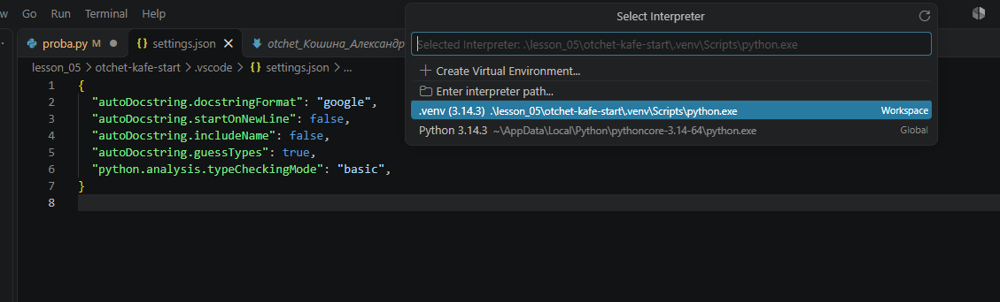
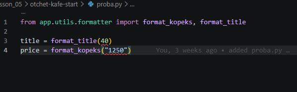
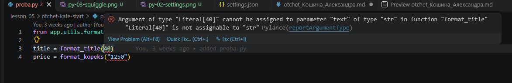
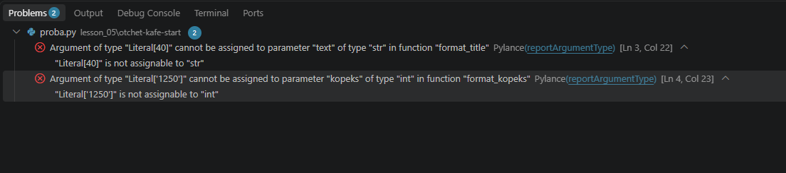
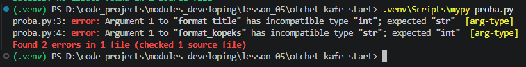
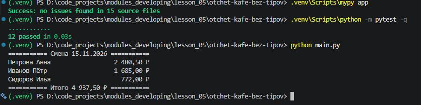

# Отчёт · Проверка типов: Pylance и mypy

**Студент:** Кошина Александра Олеговна

## 1. Подготовка




## 2. Проверка в редакторе

```python
from app.utils.formatter import format_kopeks, format_title

title = format_title(40)
price = format_kopeks("1250")
```





Разбор сообщения:

| Часть сообщения | Что означает |
|---|---|
| Argument of type "Literal[40]" | В функцию передан аргумент, который Pylance распознал как конкретное значение 40 |
| cannot be assigned to parameter "text" | Значение нельзя присвоить параметру с именем text, потому что в определении функции задан другой тип |
| of type "str" | Ожидаемый тип для параметра строка, т.е. функция format_title ждет текстовое значение, а получает число |
| in function "format_title" | Функция, в которой возникла ошибка |
| "Literal[40]" is not assignable to "str" | Тип «число 40» несовместим с типом «строка» |
| Pylance(reportArgumentType) | Код ошибки от анализатора Pylance, означает, что тип переданного аргумента не совпадает с типом, указанным в сигнатуре функции |



## 3. Проверка в терминале

```text
proba.py:3: error: Argument 1 to "format_title" has incompatible type "int"; expected "str"  [arg-type]
proba.py:4: error: Argument 1 to "format_kopeks" has incompatible type "str"; expected "int"  [arg-type]
Found 2 errors in 1 file (checked 1 source file)
```



```text
Success: no issues found in 1 source file
```

## 4. Проект без аннотаций

| Этап | Итог `mypy app` |
|---|---|
| исходно | Found 17 errors in 10 files (checked 15 source files) |
| после `utils` | Found 12 errors in 7 files (checked 15 source files) |
| после `domain` | Found 8 errors in 5 files (checked 15 source files) |
| после `services` | Found 1 errors in 1 files (checked 15 source files) |
| после `ui` | Success: no issues found in 15 source files |

Модуль до и после — clock:

```python
from datetime import date


def today_label():
    return date.today().strftime("%d.%m.%Y")
```

```python
from datetime import date


def today_label() -> str:
    return date.today().strftime("%d.%m.%Y")
```

```text
mypy app

Found 16 errors in 9 files (checked 15 source files)

python -m pytest -q

12 passed in 0.03s

python main.py

=========== Смена 15.11.2026 ===========
Петрова Анна                  2 480,50 ₽
Иванов Пётр                   1 685,00 ₽
Сидоров Илья                    772,00 ₽
=========== Итого 4 937,50 ₽ ===========
```

Модуль до и после — formatter:

```python
def format_kopeks(kopeks):
    return f"{kopeks / 100:,.2f} ₽".replace(",", " ").replace(".", ",")


def format_title(text, width=40):
    return text.center(width, "=")
```

```python
def format_kopeks(kopeks: int) -> str:
    return f"{kopeks / 100:,.2f} ₽".replace(",", " ").replace(".", ",")


def format_title(text: str, width: int =40) -> str:
    return text.center(width, "=")
```

```text
mypy app

Found 14 errors in 8 files (checked 15 source files)

python -m pytest -q

12 passed in 0.03s

python main.py

=========== Смена 15.11.2026 ===========
Петрова Анна                  2 480,50 ₽
Иванов Пётр                   1 685,00 ₽
Сидоров Илья                    772,00 ₽
=========== Итого 4 937,50 ₽ ===========
```

Модуль до и после — text:

```python
def _squash_spaces(value):
    return " ".join(value.split())


def normalize_name(name):
    return _squash_spaces(name).title()
```

```python
def _squash_spaces(value: str) -> str:
    return " ".join(value.split())


def normalize_name(name: str) -> str:
    return _squash_spaces(name).title()
```

```text
mypy app

Found 12 errors in 7 files (checked 15 source files)

python -m pytest -q

12 passed in 0.03s

python main.py

=========== Смена 15.11.2026 ===========
Петрова Анна                  2 480,50 ₽
Иванов Пётр                   1 685,00 ₽
Сидоров Илья                    772,00 ₽
=========== Итого 4 937,50 ₽ ===========
```

Модуль до и после — order:

```python
from dataclasses import dataclass

from app.utils.text import normalize_name


@dataclass(frozen=True)
class Order:
    waiter: str
    kopeks: int

    def __post_init__(self):
        if self.kopeks < 0:
            raise ValueError("Сумма заказа не может быть отрицательной")
        object.__setattr__(self, "waiter", normalize_name(self.waiter))
```

```python
from dataclasses import dataclass

from app.utils.text import normalize_name


@dataclass(frozen=True)
class Order:
    waiter: str
    kopeks: int

    def __post_init__(self) -> None:
        if self.kopeks < 0:
            raise ValueError("Сумма заказа не может быть отрицательной")
        object.__setattr__(self, "waiter", normalize_name(self.waiter))
```

```text
mypy app

Found 11 errors in 6 files (checked 15 source files)

python -m pytest -q

12 passed in 0.03s

python main.py

=========== Смена 15.11.2026 ===========
Петрова Анна                  2 480,50 ₽
Иванов Пётр                   1 685,00 ₽
Сидоров Илья                    772,00 ₽
=========== Итого 4 937,50 ₽ ===========
```

Модуль до и после — shift:

```python
from datetime import date

from app.domain.order import Order


class Shift:
    def __init__(self, day):
        self.day = day
        self.orders = []

    def add(self, order):
        self.orders.append(order)

    def total_kopeks(self):
        return sum(order.kopeks for order in self.orders)
```

```python
from datetime import date

from app.domain.order import Order


class Shift:
    def __init__(self, day: date) -> None:
        self.day = day
        self.orders: list[Order] = []

    def add(self, order: Order) -> None:
        self.orders.append(order)

    def total_kopeks(self) -> int:
        return sum(order.kopeks for order in self.orders)
```

```text
mypy app

Found 8 errors in 5 files (checked 15 source files)

python -m pytest -q

12 passed in 0.03s

python main.py

=========== Смена 15.11.2026 ===========
Петрова Анна                  2 480,50 ₽
Иванов Пётр                   1 685,00 ₽
Сидоров Илья                    772,00 ₽
=========== Итого 4 937,50 ₽ ===========
```

Модуль до и после — calculator:

```python
def calculate_average(grades):
    if not grades:
        raise ValueError("Список оценок пуст")
    return round(sum(grades) / len(grades), 2)


def grade_bounds(grades):
    if not grades:
        raise ValueError("Список оценок пуст")
    return min(grades), max(grades)
```

```python
def calculate_average(grades: list[float]) -> float:
    if not grades:
        raise ValueError("Список оценок пуст")
    return round(sum(grades) / len(grades), 2)


def grade_bounds(grades: list[float]) -> tuple[float, float]:
    if not grades:
        raise ValueError("Список оценок пуст")
    return min(grades), max(grades)
```

```text
mypy app

Found 6 errors in 4 files (checked 15 source files)

python -m pytest -q

12 passed in 0.03s

python main.py

=========== Смена 15.11.2026 ===========
Петрова Анна                  2 480,50 ₽
Иванов Пётр                   1 685,00 ₽
Сидоров Илья                    772,00 ₽
=========== Итого 4 937,50 ₽ ===========
```

Модуль до и после — importer:

```python
import csv
from collections.abc import Iterator
from pathlib import Path


def read_rows(path):
    with open(path, encoding="utf-8", newline="") as file:
        yield from csv.DictReader(file)
```

```python
import csv
from collections.abc import Iterator
from pathlib import Path


def read_rows(path: str | Path) -> Iterator[dict[str, str]]:
    with open(path, encoding="utf-8", newline="") as file:
        yield from csv.DictReader(file)
```

```text
mypy app

Found 5 errors in 3 files (checked 15 source files)

python -m pytest -q

12 passed in 0.03s

python main.py

=========== Смена 15.11.2026 ===========
Петрова Анна                  2 480,50 ₽
Иванов Пётр                   1 685,00 ₽
Сидоров Илья                    772,00 ₽
=========== Итого 4 937,50 ₽ ===========
```

Модуль до и после — orders:

```python
from pathlib import Path

from app.domain.order import Order
from app.services.importer import read_rows


def load_orders(path):
    return [
        Order(waiter=row["waiter"], kopeks=int(row["kopeks"]))
        for row in read_rows(path)
    ]


def revenue_by_waiter(orders, top=0):
    if not orders:
        raise ValueError("Список заказов пуст")
    totals = {}
    for order in orders:
        totals[order.waiter] = totals.get(order.waiter, 0) + order.kopeks
    ranked = sorted(totals.items(), key=lambda pair: -pair[1])
    if top:
        ranked = ranked[:top]
    return dict(ranked)


def sort_orders_in_place(orders):
    orders.sort(key=lambda order: -order.kopeks)
```

```python
from pathlib import Path

from app.domain.order import Order
from app.services.importer import read_rows


def load_orders(path: str | Path) -> list[Order]:
    return [
        Order(waiter=row["waiter"], kopeks=int(row["kopeks"]))
        for row in read_rows(path)
    ]


def revenue_by_waiter(orders: list[Order], top: int =0) -> dict[str, int]:
    if not orders:
        raise ValueError("Список заказов пуст")
    totals = {}
    for order in orders:
        totals[order.waiter] = totals.get(order.waiter, 0) + order.kopeks
    ranked = sorted(totals.items(), key=lambda pair: -pair[1])
    if top:
        ranked = ranked[:top]
    return dict(ranked)


def sort_orders_in_place(orders) -> None:
    orders.sort(key=lambda order: -order.kopeks)
```

```text
mypy app

Found 3 errors in 2 files (checked 15 source files)

python -m pytest -q

12 passed in 0.03s

python main.py

=========== Смена 15.11.2026 ===========
Петрова Анна                  2 480,50 ₽
Иванов Пётр                   1 685,00 ₽
Сидоров Илья                    772,00 ₽
=========== Итого 4 937,50 ₽ ===========
```

Модуль до и после — report_file:

```python
from pathlib import Path


def save_report(path, lines):
    with open(path, "w", encoding="utf-8") as file:
        file.write("\n".join(lines))
    return len(lines)

```

```python
from pathlib import Path


def save_report(path: str | Path, lines: list[str]) -> int:
    with open(path, "w", encoding="utf-8") as file:
        file.write("\n".join(lines))
    return len(lines)

```

```text
mypy app

Found 1 errors in 1 files (checked 15 source files)

python -m pytest -q

12 passed in 0.03s

python main.py

=========== Смена 15.11.2026 ===========
Петрова Анна                  2 480,50 ₽
Иванов Пётр                   1 685,00 ₽
Сидоров Илья                    772,00 ₽
=========== Итого 4 937,50 ₽ ===========
```

Модуль до и после — console:

```python
def print_report(lines):
    for line in lines:
        print(line)
```

```python
def print_report(lines: list[str]) -> None:
    for line in lines:
        print(line)
```

```text
mypy app

Success: no issues found in 15 source files

python -m pytest -q

12 passed in 0.03s

python main.py

=========== Смена 15.11.2026 ===========
Петрова Анна                  2 480,50 ₽
Иванов Пётр                   1 685,00 ₽
Сидоров Илья                    772,00 ₽
=========== Итого 4 937,50 ₽ ===========
```



## 5. Выводы

Pylance в редакторе мгновенно подсвечивает ошибки типов, не давая им попасть в код. mypy при запуске строго проверяет проект, требуя явных аннотаций. Неожиданным оказалось, что проверка не находит логических ошибок, она контролирует только соответствие типов.